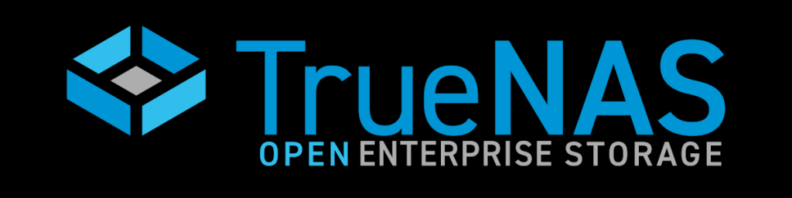
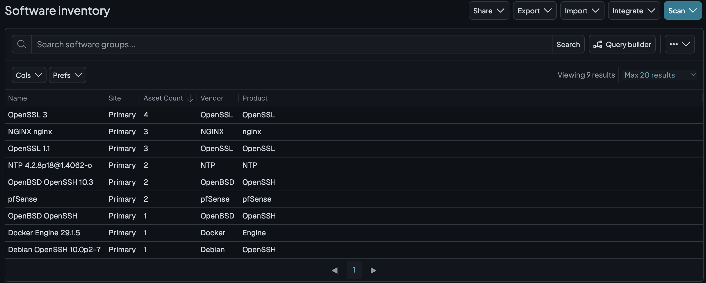
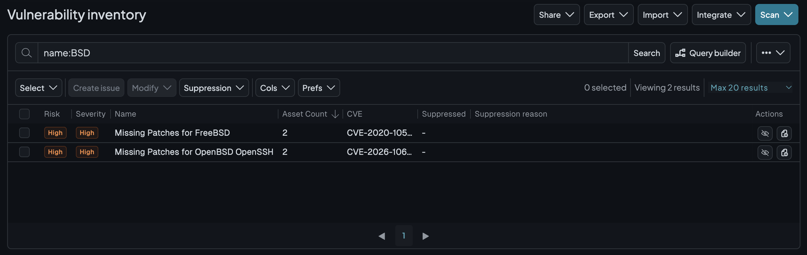

 

# runZero Explorer on TrueNAS





Deploy a runZero Explorer as a custom Docker Compose application on Linux-based TrueNAS 24.10 or newer. Manage discovery jobs and inventory through your existing runZero cloud console.

This is a community deployment configuration, not an official runZero container image. It uses the official Debian 13 slim image and downloads the Explorer directly from your organization-specific runZero URL. It does not install the runZero Console.

## Security and requirements

- **The container runs as privileged root with host networking. This substantially weakens isolation from TrueNAS and gives the container access to host devices.** A dedicated Linux VM with bridged networking is an alternative if you require a stronger isolation boundary.
- Use a wired connection to the network you are authorized to scan. Host networking shares the NAS network namespace and source IP; the Explorer has no separate container IP.
- runZero lists a 2 GHz or faster CPU, at least 8 GiB RAM for small environments (16 GiB normally), and at least 1 GB free storage. Leave memory headroom beyond TrueNAS and other apps. This configuration does not impose a memory limit.
- Select the Linux Explorer binary matching the NAS CPU architecture, normally x86_64 for Intel/AMD systems. Do not select the macOS binary when preparing the installation from a Mac.
- Allow outbound DNS, Debian package repository access, HTTPS to the Explorer download endpoint, and TCP 443 to your runZero console, including WebSocket communication. TLS-inspecting proxies may need a bypass. No inbound Internet port forwarding is needed for console communication.
- Allow scan traffic and responses between the NAS and authorized targets. Routed VLAN scans depend on routing and firewall rules; host networking does not bypass segmentation.
- TrueNAS CORE and the Kubernetes-based Apps system in SCALE 24.04 and older are not covered.

## 1. Create persistent storage

In **Datasets**, create a dedicated dataset, for example:

```text
/mnt/tank/apps/runzero
```

Keep it separate from application source code and do not expose it through SMB/NFS. Restrict access to administrators; the container needs root write access.

The dataset holds the private download URL, generated Explorer identity, executable and self-updates, and any recovery data written under `/opt/runzero`. Do not use an ephemeral container filesystem for these files.

## 2. Save the private download URL

1. Sign in to your runZero console and select the correct organization. The download URL determines which organization receives the Explorer.
2. Open **Deploy → Deploy Explorers** and copy the direct Linux Explorer download URL for your NAS architecture, not the entire shell installation command. Use your account's regional console if applicable.
3. Open the TrueNAS system shell. Replace the example dataset path below with yours, then run:

   ```sh
   sudo sh -c 'umask 077; printf "Paste Explorer URL: " >&2; IFS= read -r url && printf "%s\n" "$url" > /mnt/tank/apps/runzero/download-url'
   ```

4. At the prompt, paste the URL as one line and press Enter. The command saves the file and exits; Ctrl-D is not needed. This avoids putting the URL in shell command history. If already root, omit `sudo`.
5. Ensure the file is root-owned and readable only by root:

   ```sh
   sudo chown root:root /mnt/tank/apps/runzero/download-url
   sudo chmod 600 /mnt/tank/apps/runzero/download-url
   ```

`umask` is a shell built-in, not an executable: `sudo umask ...` does not work. The command above runs it inside `sh`. If you used an older instruction containing `cat > ...` and it appears stuck, it is waiting for pasted input and Ctrl-D; press Ctrl-C to cancel, then use the prompted command above.

Treat this URL as a credential. Do not commit it, post it in issues, or include it in screenshots. The repository ignores a local file named `download-url`, but keep the dataset outside the checkout regardless.

## 3. Install through TrueNAS Apps

1. Ensure **Apps** has a storage pool configured.
2. Open `compose.yaml` from this repository. Replace `/mnt/REPLACE_POOL/apps/runzero` with the actual dataset path. The dataset must already exist; Compose is configured not to create it silently.
3. In TrueNAS, open **Apps → Discover Apps → ⋮ → Install via YAML**. Menu placement can vary by release.
4. Name the application `runzero`, paste the edited YAML, and install.
5. Open the application's logs to watch startup.

On a fresh container, startup installs `curl` and CA certificates from Debian. On first deployment, it generates a persistent 32-character hexadecimal Explorer ID in `host-id`, downloads the Explorer to `bin/runzero-agent.bin`, and starts it in foreground `manual` mode. There is no service manager inside the container.

The download URL is not embedded in YAML or the container image. No ports are published and there is no local runZero web interface; use the cloud console.

Only one running container may use a given dataset/Explorer ID. For another Explorer, create a separate dataset and application. If cloning a dataset for a different Explorer, remove the clone's `host-id` before first startup so a new identity is generated; never run both copies with the same ID.

### Optional: Docker Compose CLI

On a Linux Docker host, or from the TrueNAS system shell if you deliberately prefer CLI management, edit the dataset path in `compose.yaml` and run:

```sh
docker compose config --quiet
docker compose up -d
docker compose logs -f explorer
```

Use the TrueNAS Apps UI **or** CLI management for an installation, not both. CLI-created containers are not managed as a TrueNAS custom App. Docker privileges may require `sudo`.

## 4. Verify and scan

1. Check logs for successful startup and console connectivity.
2. Open **Deploy → Explorers** in runZero and confirm the new Explorer is online. Give it a recognizable name.
3. Create a discovery job using this Explorer and target one known device you own on the same subnet. Check that its IP and expected services appear in inventory.
4. Restart the app in TrueNAS. Confirm the same Explorer entry returns online rather than registering a duplicate.
5. Expand the target scope to your authorized subnet, review scan load, and only then enable a recurring schedule. Exclude sensitive devices or use appropriate scan settings for them.

For additional VLANs, permit the required traffic from the NAS IP and verify routing. Local ARP and IPv6 neighbor discovery do not cross routers. Host networking also does not make all switched LAN traffic visible: comprehensive passive monitoring requires a SPAN/mirror feed or another suitable capture location.

## Updates, persistence, and removal

- The Explorer updates itself through the runZero console. `/opt/runzero` is writable and persistent, so replacing the container does not revert its executable or identity. Startup downloads a binary only when `bin/runzero-agent.bin` is absent or not executable.
- Replacing the base container reinstalls Debian dependencies at the next startup and requires package repository access. Keep `debian:13-slim` current using your chosen management method. With the CLI, use `docker compose pull` followed by `docker compose up -d`.
- To refresh the bootstrap binary manually, stop the app, update `download-url` from the console, and remove only `bin/runzero-agent.bin` from the dataset before starting. Keep `host-id` to retain the Explorer identity.
- Back up the dataset as sensitive data. Never restore and run a second copy alongside the original with the same `host-id`.
- Stop/remove the TrueNAS app to stop scanning. Removing the app does not remove the separately created dataset or the Explorer entry in runZero. Retire that entry separately; delete the dataset only when its data is no longer needed.

## Limitations and troubleshooting

- **No web screenshots:** this configuration does not install Chrome/Chromium or its dependencies. Core network discovery does not require them.
- **Missing URL:** create a non-empty `download-url` file inside the mounted dataset before initial startup. It must contain only the direct URL.
- **Download fails:** check the organization-specific URL, DNS, proxy policy, and outbound HTTPS access. Fetch a new URL from your console if necessary.
- **Package installation fails:** check connectivity to Debian repositories. Do not install packages directly into the TrueNAS host OS; this configuration installs them inside the container.
- **Permission denied:** check dataset permissions/ACLs and that the container runs as root. Do not make the dataset world-writable.
- **Explorer offline:** check logs, console connectivity on TCP 443, and TLS-inspection policy.
- **Few targets found:** verify target scope, routes, firewall rules, raw-packet access, and host networking. NAT can interfere with discovery; do not put Docker's default NAT bridge between the Explorer and scan targets.
- **Duplicate Explorer entries or conflicting jobs:** check persistence of `host-id` and ensure no other running container uses the same ID.

## References

- [runZero Explorer installation, system requirements, networking, and container guidance](https://help.runzero.com/docs/installing-an-explorer/)
- [TrueNAS custom application installation](https://apps.truenas.com/managing-apps/installing-custom-apps/)
- [Docker host networking](https://docs.docker.com/engine/network/drivers/host/)
